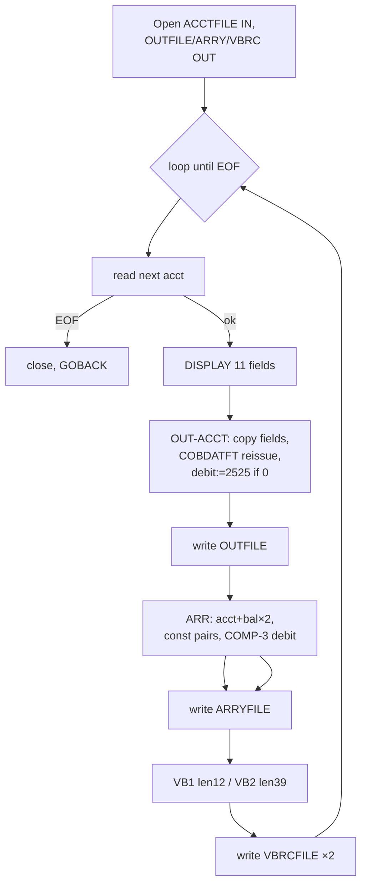

# CBACT01C — Account file reader/reformatter (batch)

JCL: `READACCT.jcl` → `STEP05 EXEC PGM=CBACT01C` (preceded by IEFBR14 PREDEL step).

## Purpose

Reads the account master sequentially and emits three demonstration outputs per record: a reformatted account extract (OUTFILE), an array-layout record (ARRYFILE), and two variable-length records (VBRCFILE). Each field is also DISPLAYed. Primarily a record-layout / file-format exerciser.

## Files

| DD | Mode | Org/Access | Record | Notes |
|---|---|---|---|---|
| ACCTFILE | INPUT | INDEXED / SEQUENTIAL, key `FD-ACCT-ID` | `ACCOUNT-RECORD` 300B (CVACT01Y) | Input master |
| OUTFILE | OUTPUT | SEQUENTIAL | `OUT-ACCT-REC` 124B | Reformat; `OUT-ACCT-CURR-CYC-DEBIT` is **COMP-3** (7B); reissue date normalized via COBDATFT |
| ARRYFILE | OUTPUT | SEQUENTIAL | `ARR-ARRAY-REC` 95B | `OCCURS 5` bal+debit pairs; debit COMP-3; only first 3 entries populated with hardcoded values |
| VBRCFILE | OUTPUT | SEQUENTIAL, RECFM V, varying 10–80 DEPENDING ON `WS-RECD-LEN` | `VBR-REC` | Two writes per input: VB1 (len 12) and VB2 (len 39) |

## External calls

- `CALL 'COBDATFT' USING CODATECN-REC` — HLASM date-format utility. Input type `2` (`YYYY-MM-DD`) → output type `2` (`YYYYMMDD`); used to normalize `ACCT-REISSUE-DATE` for OUTFILE.
- `CALL 'CEE3ABD'` — LE abend (code 999) on I/O errors.

## Business rules

- OUTFILE: pass-through fields + `OUT-ACCT-CURR-CYC-DEBIT = 2525.00` **only when** input debit is zero (constants in code, not data).
- ARRYFILE per record: `ARR-ACCT-CURR-BAL(1..2) = ACCT-CURR-BAL`, `BAL(3) = -1025.00`, `DEBIT(1..3) = 1005.00/1525.00/-2500.00`; entries 4–5 left INITIALIZEd.
- VBRCFILE per record: VB1 = acct-id + status (12B); VB2 = acct-id + curr-bal + credit-limit + reissue YYYY (39B).
- DISPLAY block prints each account field with label.

## Error handling

Non-`00`/non-`10` status on any READ/WRITE → DISPLAY + `9910` + abend. Write paragraphs oddly accept status `10` as non-fatal.

## Quirks

- `9000-ACCTFILE-CLOSE` uses `ADD 8 TO ZERO GIVING APPL-RESULT` / `SUBTRACT APPL-RESULT FROM APPL-RESULT` — assembler-era idiom for MOVE 0 / MOVE 12.
- COMP-3 fields mean output bytes are packed decimal — downstream consumers must decode BCD, not zoned.
- Only closes ACCTFILE; output files closed implicitly at GOBACK.

