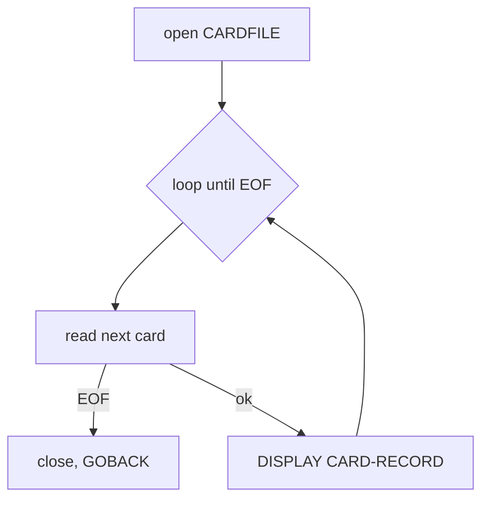

# CBACT02C — Card file reader (batch)

JCL: `READCARD.jcl` → `STEP05 EXEC PGM=CBACT02C`.

## Purpose

Reads the card master file sequentially and DISPLAYs each 150-byte `CARD-RECORD` (CVACT02Y: card-num X(16), acct-id 9(11), cvv 9(3), embossed-name X(50), expir date X(10), status X(1), filler). Pure audit/verification utility — no outputs, no updates.

## Files

| DD | Mode | Org/Access | Record |
|---|---|---|---|
| CARDFILE | INPUT | INDEXED / SEQUENTIAL, key `FD-CARD-NUM` | `CARD-RECORD` 150B |

## Error handling

Read status `10` → EOF; `00` → ok; anything else → DISPLAY + `9910` + `CEE3ABD` abend. Same close-time `ADD 8 TO ZERO` idiom as CBACT01C.

