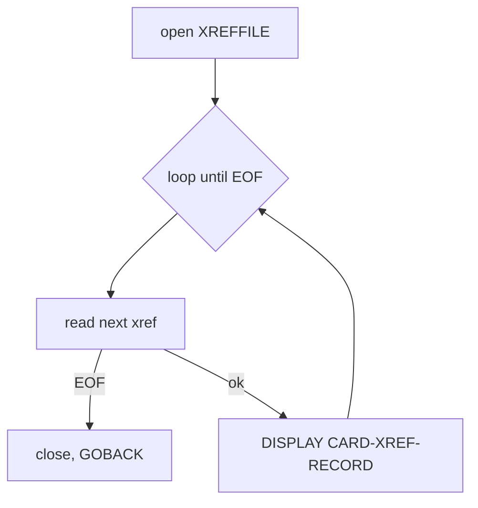

# CBACT03C — Cross-reference file reader (batch)

JCL: `READXREF.jcl` → `STEP05 EXEC PGM=CBACT03C`.

## Purpose

Identical twin of CBACT02C over the card cross-reference file: reads XREFFILE sequentially and DISPLAYs each 50-byte `CARD-XREF-RECORD` (CVACT03Y: card-num X(16), cust-id 9(09), acct-id 9(11), filler X(14)). Audit/verification utility — no outputs.

## Files

| DD | Mode | Org/Access | Record |
|---|---|---|---|
| XREFFILE | INPUT | INDEXED / SEQUENTIAL, key `FD-XREF-CARD-NUM` | `CARD-XREF-RECORD` 50B |

## Error handling

Same pattern as CBACT02C (status 10 → EOF, else abend).

